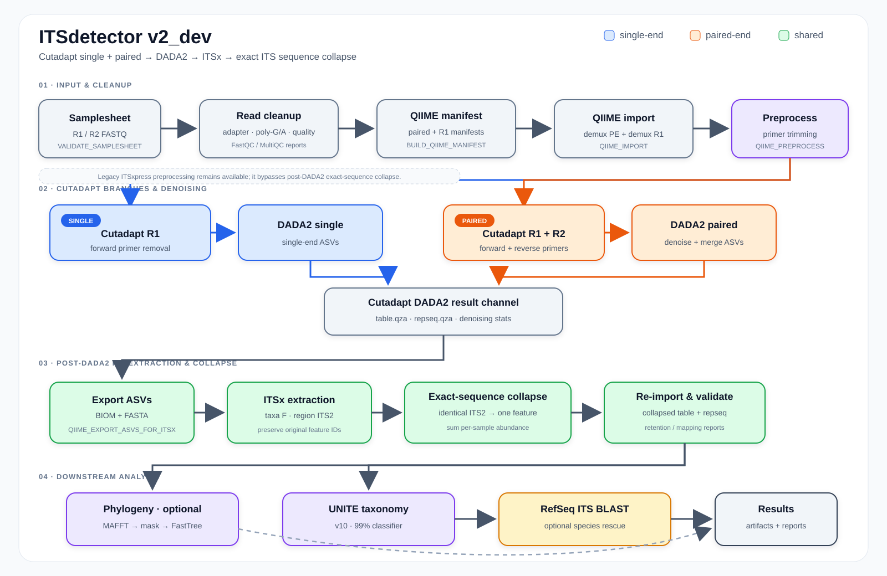

# ITSdetector v2_dev flowchart



The figure follows the `post_dada2_itsx_enabled` path implemented in `main.nf`:

1. Clean and import paired-end FASTQ files while retaining an R1-only manifest.
2. Run Cutadapt primer removal and DADA2 independently for single-end and paired-end inputs.
3. Export DADA2 feature tables and representative sequences, extract the requested ITS region with ITSx, and collapse identical extracted sequences while summing their per-sample counts.
4. Re-import the collapsed table and sequences for optional MAFFT/FastTree phylogeny, UNITE taxonomy, and RefSeq ITS BLAST reconciliation.

The older `itsx_enabled` mode preserves ASV IDs and remains available for compatibility. It is intentionally mutually exclusive with `post_dada2_itsx_enabled`, whose output uses exact-sequence-collapsed feature IDs.

## Generate the native Nextflow DAG

Nextflow can also create an interactive HTML DAG without running the analysis tasks. Run this from the repository root with an existing samplesheet path:

```bash
nextflow run . \
  -preview \
  --input /path/to/samplesheet.csv \
  --preprocess_method primer \
  --analysis_mode both \
  --post_dada2_itsx_enabled true \
  --phylogeny_enabled true \
  --taxonomy_enabled true \
  --blast_refseq_enabled true \
  -with-dag docs/nextflow_dag.html
```

Open `docs/nextflow_dag.html` in a browser. The committed HTML file was generated with Nextflow 26.04.2 using the same switches.
